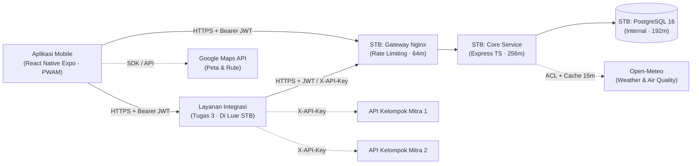

# Project Plan: StepSafe (Kelompok StepSafe, K01)

Dokumen ini menjadi acuan bersama antara **Anggota A (TST)** dan **Anggota B (PWAM)** dari fase perencanaan hingga pengumpulan akhir Tugas Besar pada **13 Desember 2026, 23.59 WIB**.

---

## 1. Identitas Proyek & Target Lingkungan
- **Nama Kelompok:** StepSafe (Kelas K01)
- **Nama Aplikasi:** StepSafe
- **Tema:** Tema 1 (Smart City & Mobility, referensi JalanKami)
- **Target Domain Publik (STB):** `https://stepsafe.stei.fun`
- **Repositori GitHub:** `https://github.com/evantanuri/StepSafe.git`

### Batasan Hardware STB (Set-Top Box)
Hasil inspeksi perangkat STB target (`aml-s9xx-box`, arsitektur `linux/arm64`):
- **RAM:** sekitar `2 GB` (dengan swap `zram` ~`959 MB`).
- **Storage:** partisi sistem `/` (`5.7 GB`) tersisa sekitar `505 MB`, sedangkan partisi `/www` (`15 GB`) tersisa sekitar `7.8 GB` dan Docker sudah diarahkan ke `/www/docker`.
- **Implikasi deploy:**
  1. Direktori deploy proyek di STB wajib diletakkan di `/www/stepsafe` (bukan `/root` atau `/home`).
  2. Setiap kontainer di `docker-compose.yml` diberi `mem_limit`, `cpus`, dan `restart: unless-stopped`.
  3. STB **hanya** menjalankan microservice inti (`db`, `core-service`, `gateway` Nginx, dan `tunnel` Cloudflared). Layanan integrasi Tugas 3, build mobile/EAS, frontend, dan model AI lokal dilarang berjalan di STB.

---

## 2. Arsitektur Target



### Pilihan Stack Implementasi
- **Backend Core Service (TST, di STB):** Node.js 20 (Express + TypeScript, multi-stage Docker build -> `node dist/index.js`, `mem_limit: 256m`) + **PostgreSQL 16** (`postgres:16-alpine`, `mem_limit: 192m`, tanpa port publik) + Swagger UI (`/docs`) dari `backend/openapi.yaml`.
- **Gateway & Tunnel (TST, di STB):** Nginx (`nginx:1.28-alpine`, `limit_req_zone` rate limiting di `gateway/nginx.conf`, `mem_limit: 64m`) + Cloudflare Tunnel (`cloudflare/cloudflared:latest`, nama tunnel `k01-stepsafe`, `mem_limit: 64m`).
- **Layanan Integrasi (TST, di luar STB):** Berjalan di laptop/VM terpisah. Menggabungkan API StepSafe, API AI opsional (narasi Area Insight), dan minimal 2 API kelompok mitra dengan timeout pendek serta cache fallback.
- **Aplikasi Mobile (PWAM):** **React Native (Expo) + TypeScript**, Google Maps API, unit test **Jest**, dan rilis **`Aplikasi_Release.apk`** via **EAS Build** dengan base URL `https://stepsafe.stei.fun/api`.

---

## 3. Rancangan Domain (DDD, Sesuai Makalah Tugas 1)

### Domain Utama
**Pedestrian Mobility and Accessibility**

### Bounded Context
1. **Walkability & Insight Context (`backend/src/modules/walkability/`):** Menghitung *Walkability Index* (`0-100`) pada titik/radius tertentu dan menyusun ringkasan wawasan kondisi trotoar (*Area Insight Summarization*).
2. **Community Reporting Context (`backend/src/modules/reporting/`):** Mengelola pelaporan hambatan fisik trotoar, penandaan hambatan disabilitas, validasi silang komunitas (`confirm` / `reject` / `resolve`), masa berlaku otomatis (TTL 7 hari), dan pembaruan skor reputasi pelapor.
3. **Identity & Access Context (`backend/src/modules/auth/`):** Menangani registrasi akun, login `Bearer JWT`, profil + skor reputasi, serta otorisasi `X-API-Key` bagi kelompok mitra.
4. **Spatial & Routing Context (External):** Google Maps API (di aplikasi mobile/integrasi) serta Open-Meteo Weather & Air Quality API yang diterjemahkan melalui *Anti-Corruption Layer* (`backend/src/external/openMeteo.acl.ts`).

### Dekomposisi Subdomain
| Klasifikasi | Subdomain | Sub-subdomain Utama |
| :--- | :--- | :--- |
| **Core** | Sidewalk Incident Reporting and Validation | Pelaporan hambatan trotoar & GPS, penandaan disabilitas, validasi silang komunitas, kedaluwarsa TTL |
| **Core** | Walkability Index Scoring | Pembobotan keparahan & penalti 1.5x hambatan disabilitas, kalkulasi Walkability Index (`0-100`), penyesuaian cuaca & AQI |
| **Supporting** | Reporter Reputation System | Riwayat kontribusi warga, perhitungan skor kredibilitas pelapor, penyaringan laporan palsu/spam |
| **Supporting** | Area Insight Summarization | Agregasi isu dominan per radius, rasio aksesibilitas disabilitas kawasan, narasi AI eksternal (opsional di luar STB) |
| **Generic** | Identity & Authentication | Register/login (`Bearer JWT`), otorisasi mitra (`X-API-Key`), rate limiting Nginx |
| **Generic** | Mapping & Pedestrian Routing | Peta & rute jalan kaki (Google Maps API), cuaca (Open-Meteo Weather), kualitas udara (Open-Meteo Air Quality) |

### Aturan Bisnis Inti
1. Laporan baru berstatus `pending` dan berubah menjadi `verified` setelah mencapai ambang batas konsensus (**>= 2 konfirmasi** dari pengguna berbeda selain pelapor), yang menaikkan `reputation_score` pelapor (`+10`) dan validator (`+2`).
2. Laporan dengan `is_disability_barrier = true` memberi penalti bobot **1.5x** lebih besar pada *Walkability Index*.
3. Setiap laporan memiliki masa berlaku otomatis (**TTL 7 hari**) agar data usang berstatus `expired` dan tidak lagi menurunkan skor area.

---

## 4. Kontrak API Resmi (`backend/openapi.yaml`)

Kontrak final tersedia di [`backend/openapi.yaml`](backend/openapi.yaml) dan dapat diuji langsung melalui Swagger UI di `/docs`. Semua respons error menggunakan format `{ "error": "CODE", "message": "Pesan jelas" }`.

| Method | Endpoint | Auth | Kegunaan Utama |
| :--- | :--- | :--- | :--- |
| `GET` | `/api/health` | Publik | Cek status layanan & koneksi PostgreSQL |
| `GET` | `/docs` | Publik | Swagger UI interaktif (OpenAPI 3.0.3) |
| `POST` | `/api/auth/register` | Publik | Registrasi akun pengguna baru (return `token` + `user`) |
| `POST` | `/api/auth/login` | Publik | Login pengguna (return `token` + `user`) |
| `GET` | `/api/auth/me` | `Bearer JWT` | Profil pengguna aktif & `reputation_score` |
| `POST` | `/api/reports` | `Bearer JWT` | Kirim laporan trotoar (`lat`, `lng`, `category`, `severity`, `is_disability_barrier`, `description`) |
| `GET` | `/api/reports` | `JWT` / `X-API-Key` | Daftar laporan (filter `lat`, `lng`, `radius`, `status`) |
| `GET` | `/api/reports/{id}` | `JWT` / `X-API-Key` | Detail satu laporan beserta jumlah validasi |
| `POST` | `/api/reports/{id}/validate` | `Bearer JWT` | Validasi silang (`confirm`, `reject`, atau `resolve`) |
| `GET` | `/api/walkability` | `JWT` / `X-API-Key` | Skor Walkability (`0-100`), label, & data cuaca/AQI (`lat`, `lng`, `radius`) |
| `GET` | `/api/insights` | `JWT` / `X-API-Key` | Area Insight Summarization: isu dominan, rasio disabilitas, skor, cuaca/AQI |

---

## 5. Struktur Repositori Aktual

```text
StepSafe/
├── README.md
├── PLAN.md
├── CONTRIBUTING.md
├── AGENTS.md
├── .env.example
├── docker-compose.yml       # db (Postgres 16), core-service, gateway (Nginx), tunnel (Cloudflared)
├── gateway/
│   └── nginx.conf           # Reverse proxy + rate limiting (limit_req_zone)
├── backend/                 # Anggota A (TST): Express TS, openapi.yaml, Dockerfile
├── integration/             # Anggota A (TST): Layanan integrasi Tugas 3 (di luar STB) + README.txt
└── frontend/                # Anggota B (PWAM): Aplikasi React Native (Expo) TypeScript + Jest + APK
```

---

## 6. Timeline Kerja & Checklist Deliverable (Minggu 13 sampai 16)

| Minggu | Periode | Fokus Bersama | Anggota A (TST) | Anggota B (PWAM) | Target Pengumpulan |
| :--- | :--- | :--- | :--- | :--- | :--- |
| **M13** | 16–22 Nov 2026 | Finalisasi domain, user story, kontrak API (`openapi.yaml`) | Selesaikan **Makalah DDD (Tugas 1)** & implementasi backend + Docker | Sumbang user story, siapkan kerangka Expo TypeScript & navigasi | **Akhir M13 (22 Nov):** Makalah DDD + cover (`.docx`/`.pdf`) |
| **M14** | 23–29 Nov 2026 | Daftar di **API Registry K01**, bagikan/minta `X-API-Key` (>= 2 kelompok) | Deploy Docker ke STB (`/www/stepsafe`), setup Cloudflare Tunnel (`k01-stepsafe`), finalisasi `README.pdf` | Bangun layar utama, login JWT, form laporan, dan konsumsi API StepSafe | **Akhir M14 (29 Nov):** URL publik `https://stepsafe.stei.fun` + entri API Registry |
| **M15** | 30 Nov–6 Des 2026 | Catat kesepakatan tertulis (endpoint, format, batas panggil, kontak) dengan >= 2 kelompok mitra | Pelajari rancangan mitra, bangun `integration/` (di luar STB) dengan timeout & cache fallback | Integrasikan API >= 2 kelompok mitra, tangani loading/error/empty/mitra-mati, tulis unit test Jest | - |
| **M16** | 7–13 Des 2026 | Uji **end-to-end**, rekam **video YouTube** (keduanya tampil sebagai presenter + tanggapan rancangan mitra) | Finalisasi repo + `README.pdf` & `integration/README.txt` | Build `Aplikasi_Release.apk` (EAS, HTTPS), branding ikon/splash, laporan testing (`.pdf`) | **Akhir M16 (13 Des, 23.59 WIB):** Semua tautan final di **Edunex** |

### Daftar Tautan Final Edunex
1. Makalah DDD + cover (`.docx` / `.pdf`) -> Evan (dibantu Satria)
2. URL microservice (`stepsafe.stei.fun`) + entri API Registry -> Evan
3. Repositori GitHub + `README.pdf` -> Evan
4. URL / program lokal layanan integrasi + `README.txt` -> Evan
5. Laporan testing aplikasi (`.pdf`) -> Satria
6. Repositori aplikasi + `Aplikasi_Release.apk` -> Satria
7. Link YouTube video penjelasan (Evan & Satria tampil) -> Bersama
