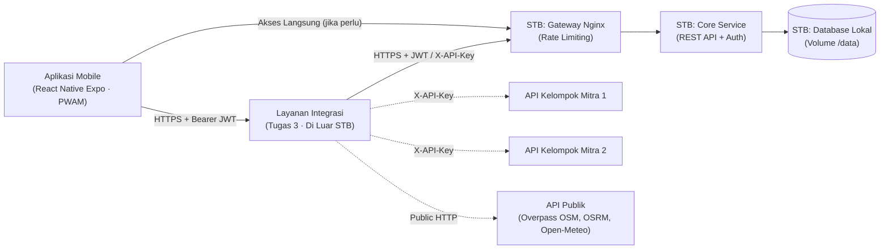

# Project Plan: StepSafe (Kelompok MaturXiexie, K01)

Dokumen ini menjadi acuan bersama antara **Anggota A (TST)** dan **Anggota B (PWAM)** selama fase perencanaan hingga pengumpulan akhir Tugas Besar pada **13 Desember 2026, 23.59 WIB**.

---

## 1. Identitas Proyek & Target Lingkungan
- **Nama Kelompok:** MaturXiexie (Kelas K01)
- **Nama Aplikasi:** StepSafe
- **Tema:** Tema 1 (Smart City & Mobility)
- **Target Domain Publik (STB):** `https://stepsafe.stei.fun`
- **Catatan Konsistensi Penamaan:** Sesuai ketentuan penamaan kelas (huruf kecil `a-z`, angka, `-`, 3 sampai 20 karakter), subdomain STB menggunakan `stepsafe.stei.fun` sementara repositori GitHub bernama `MaturXiexie`. Pastikan entri di spreadsheet API Registry kelas konsisten dan terhubung ke repositori ini.

### Batasan Hardware STB (Set-Top Box)
Hasil inspeksi perangkat STB target (`aml-s9xx-box`, arsitektur `linux/arm64`):
- **RAM:** sekitar `2 GB` (dengan swap `zram` ~`959 MB`).
- **Storage:** partisi sistem `/` (`5.7 GB`) tersisa sekitar `505 MB`, sedangkan partisi `/www` (`15 GB`) tersisa sekitar `7.8 GB` dan Docker sudah diarahkan ke `/www/docker`.
- **Implikasi perencanaan:**
  1. Direktori deploy proyek di STB wajib diletakkan di `/www/stepsafe` (bukan `/root` atau `/home`) agar tidak memenuhi `/`.
  2. Setiap kontainer di `docker-compose.yml` wajib diberi `mem_limit`, `cpus`, dan `restart: unless-stopped`.
  3. STB **hanya** menjalankan microservice inti (`core-service`, `gateway` Nginx, dan `tunnel` Cloudflared). Layanan integrasi Tugas 3, build mobile/EAS, frontend, dan model AI lokal dilarang berjalan di STB.

---

## 2. Arsitektur Target



### Pilihan Stack Rencana
- **Backend Core Service (TST, di STB):** Node.js (Express + TypeScript) + SQLite, atau FastAPI (Python) + SQLite. Fokus pada footprint memori kecil (`mem_limit: 256m`), dukungan `linux/arm64`, dan dokumentasi otomatis OpenAPI / Swagger UI (`/docs`).
- **Gateway & Tunnel (TST, di STB):** Nginx (`nginx:1.28-alpine`, `limit_req_zone` untuk rate limit) + Cloudflare Tunnel (`cloudflare/cloudflared:latest`, nama tunnel `k01-stepsafe`).
- **Layanan Integrasi (TST, di luar STB):** Berjalan di laptop/VM terpisah. Menggabungkan API StepSafe, API publik, dan minimal 2 API kelompok lain dengan timeout pendek serta cache fallback agar tahan gangguan.
- **Aplikasi Mobile (PWAM):** **React Native (Expo) + TypeScript** (wajib sesuai ketentuan PWAM), unit test **Jest**, dan rilis **`Aplikasi_Release.apk`** via **EAS Build** dengan base URL HTTPS.

---

## 3. Rancangan Domain (DDD, Tugas 1)

### Domain Utama
**Walkability dan Aksesibilitas Pejalan Kaki Perkotaan**

### Bounded Context
1. **Konteks Pelaporan dan Infrastruktur Trotoar (Core):** Akuisisi laporan warga (kategori kerusakan/hambatan, tingkat keparahan `1-5`, penanda `disability_barrier`, koordinat GPS) serta sinkronisasi metadata jalur pejalan kaki.
2. **Konteks Skoring Walkability dan Rute Pejalan Kaki (Core):** Menghitung *Walkability Score* (`0-100`) pada titik/radius tertentu dan menyusun saran rute pejalan kaki aman.
3. **Konteks Verifikasi dan Reputasi Komunitas (Supporting):** Mengelola konsensus verifikasi warga (`confirm` / `resolve`) dan skor kredibilitas pelapor.
4. **Konteks Pengguna, Ringkasan Area, dan Pantauan (Supporting + Generic):** Autentikasi JWT/API Key, *Area Summarizer*, dan daftar koridor pantauan favorit pengguna.
5. **Anti-Corruption Layer (ACL) Eksternal:** Menerjemahkan respons API publik (Overpass OSM, OSRM Foot Routing, Open-Meteo) serta konteks layanan minimal 2 kelompok mitra tanpa mengikat skema internal.

### Dekomposisi Subdomain
| Klasifikasi | Subdomain | Sub-subdomain Utama |
| :--- | :--- | :--- |
| **Core** | Pelaporan & Verifikasi Kondisi Trotoar | Akuisisi laporan warga, penandaan hambatan disabilitas, validasi silang komunitas, kedaluwarsa laporan (TTL) |
| **Core** | Skoring Walkability & Rute Aman | Kalkulasi *Walkability Score*, bobot penalti hambatan disabilitas, rekomendasi rute menghindari titik rawan |
| **Supporting** | Area Summarizer & Pantauan Koridor | Agregasi isu dominan per radius, daftar pantauan favorit, narasi ringkasan (via layanan integrasi/AI eksternal opsional) |
| **Supporting** | Reputasi & Kredibilitas Kontributor | Riwayat kontribusi, poin kepercayaan pelapor, pencegahan spam |
| **Generic** | Autentikasi & Manajemen Akses | Register/login (`Bearer JWT`), otorisasi mitra (`X-API-Key`), rate limiting Nginx |
| **Generic** | Peta Dasar, OSM & Cuaca | Peta dasar OSM, jaringan pedestrian OSRM/Overpass, prakiraan hujan Open-Meteo |

### Aturan Bisnis Inti
1. Laporan baru berstatus terverifikasi setelah mencapai ambang batas konfirmasi komunitas.
2. Laporan yang menandai hambatan disabilitas (`disability_barrier = true`) memberi penalti bobot lebih besar terhadap *Walkability Score*.
3. Setiap laporan memiliki masa berlaku (TTL) agar data lama yang sudah tidak relevan tidak terus menurunkan skor area.

---

## 4. Rencana Kontrak API Awal (Sinkronisasi TST dan PWAM)

Kontrak final akan dituangkan ke `openapi.yaml` sebelum implementasi agar backend dan mobile dapat dikerjakan paralel:

| Method | Endpoint | Auth | Kegunaan Utama |
| :--- | :--- | :--- | :--- |
| `GET` | `/api/health` | Publik | Cek status layanan & database |
| `POST` | `/api/auth/register` | Publik | Registrasi akun pengguna mobile |
| `POST` | `/api/auth/login` | Publik | Login dan mendapatkan JWT `access_token` |
| `GET` | `/api/auth/me` | `Bearer JWT` | Profil pengguna & skor reputasi |
| `GET` | `/api/reports` | Publik | Daftar laporan aktif (filter `lat`, `lon`, `radius_m`, `category`, `status`) |
| `POST` | `/api/reports` | `Bearer JWT` | Kirim laporan kondisi trotoar baru |
| `GET` | `/api/reports/{id}` | Publik | Detail satu laporan |
| `POST` | `/api/reports/{id}/verify` | `Bearer JWT` | Verifikasi komunitas (`confirm` / `resolve`) |
| `GET` | `/api/walkability/score` | `JWT` / `X-API-Key` | Skor walkability (`0-100`) pada titik & radius |
| `GET` | `/api/areas/summary` | `JWT` / `X-API-Key` | Ringkasan statistik masalah pada radius tertentu |
| `GET/POST/DELETE` | `/api/watchlists` | `Bearer JWT` | Kelola koridor pantauan favorit pengguna |

---

## 5. Rencana Struktur Repositori Saat Masuk Implementasi

```text
MaturXiexie/
├── README.md
├── PLAN.md
├── CONTRIBUTING.md
├── AGENTS.md
├── docs/              # Dokumentasi API (README.pdf untuk Tugas 2) & openapi.yaml
├── backend/           # Anggota A (TST): Core microservice, Nginx gateway, docker-compose.yml STB
├── integration/       # Anggota A (TST): Layanan integrasi Tugas 3 (di luar STB) + README.txt
└── frontend/          # Anggota B (PWAM): Aplikasi React Native (Expo) TypeScript + Jest + APK
```

---

## 6. Timeline Kerja & Checklist Deliverable (Minggu 13 sampai 16)

| Minggu | Periode | Fokus Bersama | Anggota A (TST) | Anggota B (PWAM) | Target Pengumpulan |
| :--- | :--- | :--- | :--- | :--- | :--- |
| **M13** *(berjalan)* | 16–22 Nov 2026 | Finalisasi domain, user story, kontrak API awal | Selesaikan **Makalah DDD (Tugas 1)** & spesifikasi `openapi.yaml` | Sumbang user story, siapkan kerangka Expo TypeScript & navigasi | **Akhir M13 (22 Nov):** Makalah DDD + cover (`.docx`/`.pdf`) |
| **M14** | 23–29 Nov 2026 | Daftar di **API Registry K01**, bagikan/minta `X-API-Key` (>= 2 kelompok) | Bangun `backend/` + Auth (JWT & `X-API-Key`), deploy Docker ke STB (`/www/stepsafe`), setup Cloudflare Tunnel | Bangun layar utama, login JWT, form laporan, dan konsumsi API StepSafe | **Akhir M14 (29 Nov):** URL publik `https://stepsafe.stei.fun` + entri API Registry |
| **M15** | 30 Nov–6 Des 2026 | Catat kesepakatan tertulis (endpoint, format, batas panggil, kontak) dengan >= 2 kelompok mitra | Pelajari rancangan mitra, bangun `integration/` (di luar STB) dengan timeout & cache fallback | Integrasikan API >= 2 kelompok mitra, tangani loading/error/empty/mitra-mati, tulis unit test Jest | - |
| **M16** | 7–13 Des 2026 | Uji **end-to-end**, rekam **video YouTube** (keduanya tampil sebagai presenter + tanggapan rancangan mitra) | Finalisasi repo + `README.pdf` & `integration/README.txt` | Build `Aplikasi_Release.apk` (EAS, HTTPS), branding ikon/splash, laporan testing (`.pdf`) | **Akhir M16 (13 Des, 23.59 WIB):** Semua tautan final di **Edunex** |

### Daftar Tautan Final Edunex
1. Makalah DDD + cover (`.docx` / `.pdf`) -> Evan (dibantu Satria)
2. URL microservice (`stepsafe.stei.fun`) + entri API Registry -> Evan
3. Repositori GitHub + `README.pdf` -> Evan
4. URL / program lokal layanan integrasi + `README.txt` -> Evan
5. Laporan testing aplikasi (`.pdf`) -> Satria
6. Repositori aplikasi + `Aplikasi_Release.apk` -> Satria
7. Link YouTube video penjelasan (Evan & Satria tampil) -> Bersama
