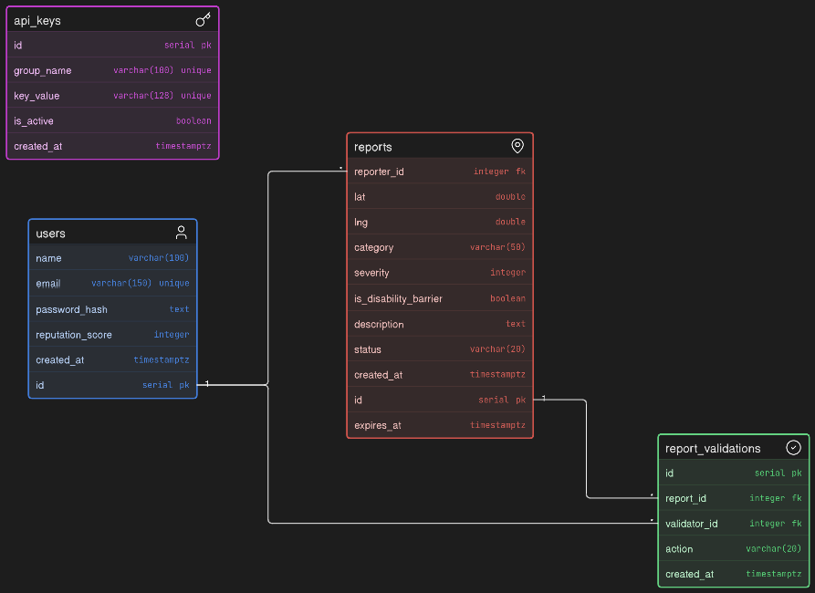

# StepSafe Core Microservice (Kelompok StepSafe, Kelas K01)

**StepSafe** adalah sistem intelijen *walkability* dan aksesibilitas pejalan kaki perkotaan (Tema 1: Smart City & Mobility, adaptasi konsep *JalanKami*) untuk Tugas Besar gabungan mata kuliah **II3160 Teknologi Sistem Terintegrasi (TST)** dan **II3140 Pengembangan Aplikasi Web & Mobile (PWAM)** di STEI ITB.

- **URL Live Microservice (Base API):** `https://stepsafe.stei.fun/api`
- **Health Check:** `https://stepsafe.stei.fun/api/health`
- **Dokumentasi Interaktif (Swagger UI):** `https://stepsafe.stei.fun/api/docs`
- **Kontrak OpenAPI 3.0.3:** [`backend/openapi.yaml`](backend/openapi.yaml)
- **Repositori GitHub:** `https://github.com/evantanuri/MaturXiexie`

## Anggota Kelompok & Pembagian Peran
| Anggota | NIM | Peran | Tanggung Jawab Utama |
| :--- | :--- | :--- | :--- |
| **Evan Nathanael Tanuri** | `18224019` | **TST (Anggota A)** | Perancangan DDD (Tugas 1), Core Microservice + PostgreSQL + Auth + Docker STB via Cloudflare Tunnel (Tugas 2), Layanan Integrasi lintas kelompok (Tugas 3). |
| **Satria Guna Darma** | `18224011` | **PWAM (Anggota B)** | Aplikasi mobile `frontend/` React Native (Expo) + TypeScript, konsumsi API sendiri dan >= 2 kelompok lain, unit testing (Jest), branding, dan build `Aplikasi_Release.apk`. |

---

## 1. Arsitektur Microservice di STB

Microservice StepSafe dirancang mengikuti pola **Modular Monolith** berdasarkan 4 Bounded Context DDD (Tugas 1) dan dijalankan sepenuhnya di dalam **Docker Compose** pada perangkat Set-Top Box (`aml-s9xx-box`, `linux/arm64`, lokasi `/www/stepsafe`).

```text
Internet (https://stepsafe.stei.fun/api/...)
  -> Cloudflare Tunnel (container: tunnel · cloudflared · 64m)
    -> Gateway Reverse Proxy (container: gateway · nginx:1.28-alpine · 64m · rate limit 10r/s)
      -> Core Service (container: core-service · Node.js 20 Express TS · 256m)
        ├── Database Internal (container: db · postgres:16-alpine · 192m · tanpa port publik)
        └── Anti-Corruption Layer -> Open-Meteo Weather & Air Quality API (cache 15 menit + timeout 5s + fallback)
```

### Pemisahan Modul (`backend/src/`)
- `modules/auth/` (*Identity & Access Context*): registrasi akun, login `Bearer JWT`, profil + skor reputasi, dan verifikasi `X-API-Key` kelompok mitra.
- `modules/reporting/` (*Community Reporting Context*): pelaporan hambatan trotoar & flag disabilitas, filter radius Haversine, validasi silang komunitas (`confirm` / `reject` / `resolve`, ambang >= 2 konfirmasi -> `verified`), reputasi pelapor, dan kedaluwarsa otomatis (TTL 7 hari).
- `modules/walkability/` (*Walkability & Insight Context*): kalkulasi *Walkability Index* (`0-100`) dengan penalti 1.5x untuk hambatan disabilitas serta agregasi *Area Insight Summarization*.
- `external/openMeteo.acl.ts` (*Anti-Corruption Layer*): mengambil data suhu, hujan, European AQI, dan PM2.5 dari Open-Meteo dengan cache 15 menit dan fallback aman (`is_fallback: true`) agar tahan gangguan.

### Batas Resource & Keamanan STB (`docker-compose.yml`)
| Service | Image / Build | `mem_limit` | `cpus` | `restart` | Keterangan |
| :--- | :--- | :---: | :---: | :---: | :--- |
| `db` | `postgres:16-alpine` | `192m` | `0.25` | `unless-stopped` | Jaringan internal Docker saja (tidak membuka port ke internet), volume persisten `stepsafe_pgdata` |
| `core-service` | Multi-stage `node:20-alpine` | `256m` | `0.50` | `unless-stopped` | Compile `tsc` di stage builder, runtime jalankan `node dist/index.js` |
| `gateway` | `nginx:1.28-alpine` | `64m` | `0.20` | `unless-stopped` | Reverse proxy + rate limit `10 req/s` (`burst=20`, JSON `429`) |
| `tunnel` | `cloudflare/cloudflared:latest` | `64m` | `0.20` | `unless-stopped` | Cloudflare Tunnel -> `http://gateway:80` tanpa buka port router |

---

## 2. Skema Database (PostgreSQL 16)



- **`users`**: menyimpan akun pengguna, hash password (`bcryptjs`), dan `reputation_score` (default `100`).
- **`api_keys`**: menyimpan kunci `X-API-Key` terpisah untuk tiap kelompok mitra (`1 key per kelompok`, mudah dicabut lewat `is_active`).
- **`reports`**: menyimpan laporan trotoar (`lat`, `lng`, `category`, `severity` 1-5, `is_disability_barrier`, `status`, dan `expires_at` untuk TTL 7 hari).
- **`report_validations`**: mencatat validasi silang antarwarga dengan constraint `UNIQUE (report_id, validator_id)` agar satu pengguna tidak bisa memvalidasi laporan yang sama lebih dari sekali.

---

## 3. Daftar Endpoint API

Dokumentasi interaktif lengkap tersedia di **`https://stepsafe.stei.fun/api/docs`** dan skema mentahnya di [`backend/openapi.yaml`](backend/openapi.yaml). Semua error memakai format seragam `{ "error": "CODE", "message": "Pesan jelas" }`.

| Method | Endpoint | Autentikasi | Fungsi |
| :--- | :--- | :--- | :--- |
| `GET` | `/api/health` | Publik | Cek status microservice dan koneksi PostgreSQL |
| `GET` | `/api/docs` | Publik | Swagger UI interaktif (OpenAPI 3.0.3) |
| `POST` | `/api/auth/register` | Publik | Registrasi akun pengguna baru (mengembalikan `token` JWT & profil) |
| `POST` | `/api/auth/login` | Publik | Login pengguna (mengembalikan `token` JWT & profil) |
| `GET` | `/api/auth/me` | `Bearer JWT` | Profil pengguna aktif beserta `reputation_score` |
| `POST` | `/api/reports` | `Bearer JWT` | Buat laporan kondisi trotoar baru (status awal `pending`, TTL 7 hari) |
| `GET` | `/api/reports` | `JWT` / `X-API-Key` | Ambil daftar laporan (filter query: `lat`, `lng`, `radius`, `status`) |
| `GET` | `/api/reports/{id}` | `JWT` / `X-API-Key` | Detail satu laporan beserta jumlah `confirm`, `reject`, `resolve` |
| `POST` | `/api/reports/{id}/validate` | `Bearer JWT` | Validasi silang (`confirm`, `reject`, `resolve`) oleh pengguna selain pelapor |
| `GET` | `/api/walkability` | `JWT` / `X-API-Key` | Kalkulasi *Walkability Index* (`0-100`), label, serta data cuaca & AQI terkini |
| `GET` | `/api/insights` | `JWT` / `X-API-Key` | *Area Insight Summarization*: isu dominan, rasio hambatan disabilitas, skor, cuaca & AQI |

---

## 4. Cara Mendapatkan Akses

### A. Pengguna Aplikasi Mobile (`Bearer JWT`)
1. Daftar akun baru lewat `POST /api/auth/register`, atau gunakan akun demo bawaan:
   - **Email:** `demo@stepsafe.test`
   - **Password:** `demo123`
   *(Akun demo tambahan untuk uji validasi silang: `evan@stepsafe.test` / `evan123` dan `satria@stepsafe.test` / `satria123`.)*
2. Kirim token yang diperoleh pada header: `Authorization: Bearer <token>`.

### B. Kelompok Mitra (`X-API-Key`)
1. Untuk pengujian cepat di Swagger UI / Postman, tersedia kunci uji:
   - **Header:** `X-API-Key: stepsafe_key_mitra_health_2026`
2. Untuk integrasi Tugas 3, setiap kelompok mitra akan diberikan **1 API key khusus per kelompok**. Hubungi Anggota A (Evan Nathanael Tanuri, `18224019`) melalui kontak di spreadsheet API Registry kelas K01 atau buat GitHub Issue di repositori ini.

---

## 5. Contoh Request & Response

### 1. Health Check (Publik)
```bash
curl -s https://stepsafe.stei.fun/api/health
```
```json
{
  "status": "ok",
  "service": "stepsafe-core",
  "database": "connected",
  "timestamp": "2026-11-22T13:00:15.361Z"
}
```

### 2. Login untuk Mendapatkan Bearer JWT
```bash
curl -s -X POST https://stepsafe.stei.fun/api/auth/login \
  -H "Content-Type: application/json" \
  -d '{"email":"demo@stepsafe.test","password":"demo123"}'
```

### 3. Ambil Walkability Index sebagai Kelompok Mitra (`X-API-Key`)
```bash
curl -s "https://stepsafe.stei.fun/api/walkability?lat=-6.8915&lng=107.6107&radius=500" \
  -H "X-API-Key: stepsafe_key_mitra_health_2026"
```
```json
{
  "lat": -6.8915,
  "lng": 107.6107,
  "radius_m": 500,
  "score": 56,
  "label": "Cukup",
  "verified_report_count": 2,
  "disability_barrier_count": 1,
  "environment": {
    "temperature_c": 23.9,
    "rain_mm": 0,
    "european_aqi": 74,
    "pm2_5": 78.9,
    "source": "open-meteo",
    "is_fallback": false
  }
}
```

### 4. Kirim Laporan Trotoar Baru (`Bearer JWT`)
```bash
curl -s -X POST https://stepsafe.stei.fun/api/reports \
  -H "Authorization: Bearer <TOKEN_JWT>" \
  -H "Content-Type: application/json" \
  -d '{
    "lat": -6.8912,
    "lng": 107.6105,
    "category": "no_tactile_paving",
    "severity": 4,
    "is_disability_barrier": true,
    "description": "Tidak ada jalur pemandu tunanetra di trotoar sisi barat."
  }'
```

### 5. Contoh Error Autentikasi (`401`) & Rate Limit (`429`)
- Tanpa header auth / kunci salah (`HTTP 401`):
  ```json
  {"error":"UNAUTHORIZED","message":"Diperlukan header Authorization (Bearer JWT) atau X-API-Key yang valid."}
  ```
- Melebihi batas rate limit Nginx (`HTTP 429`):
  ```json
  {"error":"TOO_MANY_REQUESTS","message":"Batas permintaan terlampaui. Coba lagi beberapa saat."}
  ```

---

## 6. Menjalankan Layanan (Lokal & STB)

### Lokal (Tanpa Tunnel)
```bash
cp .env.example .env
docker compose up -d --build db core-service gateway
# Akses lokal: http://localhost:8088/api/docs dan http://localhost:8088/api/health
```

### Produksi di STB (`/www/stepsafe`)
```bash
git clone -b develop https://github.com/evantanuri/MaturXiexie.git /www/stepsafe
cd /www/stepsafe
cp .env.example .env
# Isi POSTGRES_PASSWORD, JWT_SECRET acak, dan TUNNEL_TOKEN di .env (jangan pernah di-commit)
docker compose up -d --build
docker compose ps
```

## Dokumen Lain di Repositori Ini
- [`backend/openapi.yaml`](backend/openapi.yaml) : Spesifikasi OpenAPI 3.0.3.
- [`PLAN.md`](PLAN.md) : Arsitektur target, DDD, kontrak API, dan timeline.
- [`CONTRIBUTING.md`](CONTRIBUTING.md) : Panduan kolaborasi Git dan kepemilikan modul.
- [`AGENTS.md`](AGENTS.md) : Panduan konteks dan aturan STB untuk AI coding agent.
